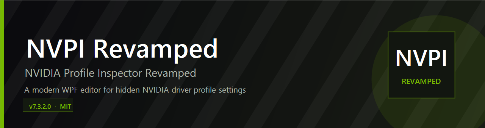
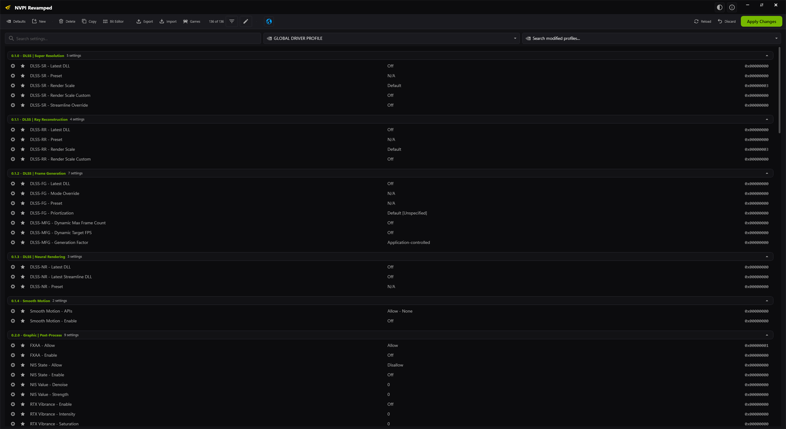
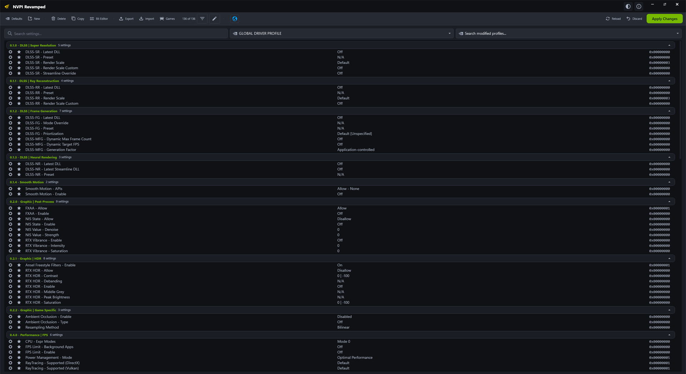
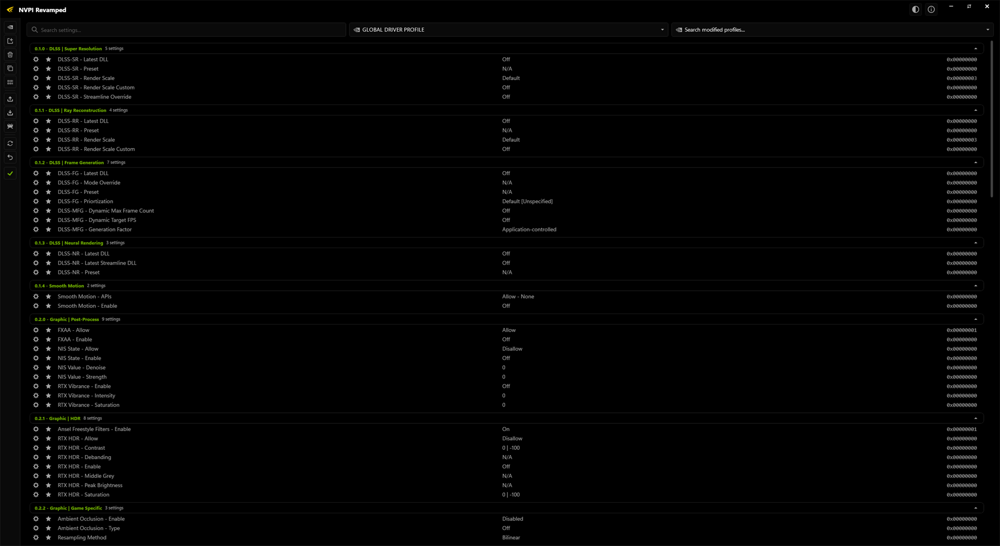

<p align="center">
  
</p>

<p align="center">
  <a href="https://github.com/xHybred/NvidiaProfileInspectorRevamped/releases"></a>
  
  
  <a href="LICENSE"></a>
</p>

# NVPI Revamped

**NVIDIA Profile Inspector Revamped** (NVPI-R) is a modern, actively maintained fork of the classic
[NVIDIA Profile Inspector](https://github.com/Orbmu2k/nvidiaProfileInspector) by Orbmu2k.

It edits the profiles inside the NVIDIA driver database. Profiles ship with the driver, but you can also
create your own for games and applications that NVIDIA does not provide one for. Everything the NVIDIA
Control Panel exposes is available here, plus the many hidden and undocumented driver settings it does not.

> This is a fork, not the original project. It shares the same purpose and driver database, but the UI,
> setting organisation and feature set have diverged significantly. The original project is still available
> at [Orbmu2k/nvidiaProfileInspector](https://github.com/Orbmu2k/nvidiaProfileInspector).

---

## Why this fork exists

NVPI was abandoned for years while the community built separate forks with different improvements. NVPI
Revamped was created to combine those efforts into one maintained tool and to keep pushing it forward.

The goals are straightforward:

- Make the tool friendlier and more modern without hiding what it actually does.
- Document and name unknown or unnamed driver settings so changes are not blind guesses.
- Organise settings in a way that makes sense: consistent groups, ordered drop-down values, clearer descriptions.
- Support new driver features and settings as they appear.
- Provide a UI that people actually want to use, with themes, display density options and keyboard navigation.

### What is different from the original

| Area | NVPI Revamped |
| --- | --- |
| UI | Complete WPF rewrite with a custom title bar, top toolbar or side rail, and a resizable settings grid |
| Themes | Six built-in themes: Onyx, Midnight, Vanta, Ember, Slate and Clean White |
| Density | Modern, Compact and Classic layouts, plus Modern/Classic text rendering |
| Window effects | Mica, Mica Variant, Acrylic, Glass and Disabled backdrop modes |
| Settings sources | Common (CSN), Driver API, Driver Constants, Reference and Predefined Scan, all individually toggleable |
| Search | Full-text filter with advanced source/value filters, filter presets, modified-only mode and search across modified profiles |
| Editing | Inline value editors, bit editor, favourites, setting descriptions, copy to clipboard, per-profile reload and discard |
| Profiles | Create, delete, import and export profiles, drag-and-drop `.nip` files, and OS file association |
| Games | Built-in installed-game detection for Steam and Epic, with a searchable game library |
| Updates | Built-in updater with Release and Prerelease channels |
| Window handling | Saved window placement is validated against your current monitors and recovered automatically (7.3.2+) |
| Quality of life | Command palette, keyboard shortcuts, single-instance import forwarding, crash logs, high-DPI support |

---

## Screenshots

**Onyx theme, Modern density, top toolbar**



**Midnight theme, Classic density**



**Vanta theme, Compact density, side rail**



---

## Requirements

- Windows 10 or Windows 11 (64-bit)
- [.NET Framework 4.8](https://dotnet.microsoft.com/download/dotnet-framework/net48) (included with current Windows versions)
- An NVIDIA GPU with a compatible driver installed
- Administrator rights (the app needs them to write to the driver profile database)

NVPI-R only edits NVIDIA driver profiles. It is not a GPU overclocking tool, a driver installer, or a
replacement for the NVIDIA Control Panel.

---

## Download and install

1. Download the latest `nvidiaProfileInspector.zip` from the [Releases page](https://github.com/xHybred/NvidiaProfileInspectorRevamped/releases).
2. Extract it anywhere you like.
3. Run `NVPI-R.exe` and accept the elevation prompt.

The app is portable by default. To update, close the app and extract a newer release over the same folder,
or use the built-in updater (`About > Check for updates`).

### Settings and portable mode

Settings are stored in:

```
%LOCALAPPDATA%\nvidiaProfileInspector\settings.xml
```

If a `settings.xml` exists in the folder you launch the app from, that file is used instead. This is useful
for keeping a self-contained portable copy, for example on a USB drive.

Deleting `settings.xml` resets the interface to defaults. It does not touch your driver profiles.

---

## Quick start

1. Pick a profile from the profile drop-down, or select **GLOBAL DRIVER PROFILE** to edit the base profile.
2. Search for a setting with the search box or **Ctrl+F**.
3. Change the value. Modified rows are highlighted.
4. Press **Apply Changes** (or **Ctrl+S**) to write the profile to the driver database.
5. Use **New** to create a profile and **Add application** to associate an executable with it.

Changes are written to the NVIDIA driver database, not to a game's configuration files. Restarting the game
is usually enough for new settings to take effect.

> Hidden driver settings can affect stability, anti-cheat behaviour and image quality. Change one thing at a
> time and use **Discard** if a change causes problems.

---

## Features in detail

### Search and filtering

- Full-text search across setting names, descriptions and values.
- Source filters for **Common (CSN)**, **Driver API**, **Driver Constants**, **Reference** and **Predefined Scan**.
- Value-source filters, modified-only mode, and options to merge duplicate values from different sources.
- Advanced filters for showing active settings from disabled sources, or taking names and descriptions from them.
- Filter presets for a curated view or for showing everything.
- **Search modified profiles** to find profiles with customised settings.

### Profiles and games

- **New**, **Delete**, **Copy** and **Export** profiles; import from `.nip` files with merge or replace modes.
- Drag and drop `.nip` files onto the window, or open them directly from Explorer.
- **Games** opens the installed-game browser. Steam and Epic installations are detected automatically, and
  game executables can be added to the selected profile or to the common application list.
- **Reload** re-reads profiles from the driver; **Discard** drops unsaved edits.
- Favourite settings with the star column so they stay within reach.

### Editing tools

- Inline searchable drop-downs and text editors depending on the setting type.
- **Bit Editor** for flag values, with named bits and a live raw value.
- Setting descriptions on hover, setting IDs on request, and double-click a setting name to copy its ID.
- Per-setting resets and a profile-wide **Restore defaults** action.

### Appearance

- Six themes: Onyx, Midnight, Vanta, Ember, Slate and Clean White.
- Display density: Modern, Compact or Classic.
- Text rendering: Modern (Segoe UI Variable) or Classic.
- Toolbar layout: top bar or side rail; optional status bar.
- Window backdrop: Mica, Mica Variant, Acrylic, Glass or Disabled (depends on Windows version and GPU).

The appearance menu is available from the title bar.

### Updates

The app can check GitHub releases for updates and install them in place. Choose the **Release** channel for
stable builds or **Prerelease** for early builds. Update checks can be disabled in the About dialog.

---

## Keyboard shortcuts

| Shortcut | Action |
| --- | --- |
| `Ctrl+F` | Focus the search box |
| `Ctrl+K` | Open the command palette |
| `Ctrl+S` | Apply changes |
| `Ctrl+R` | Reload profiles from the driver |
| `Ctrl+Alt+D` | Toggle developer mode |
| `Esc` | Clear the current filter |
| `Double-click a setting name` | Copy the setting ID |
| `Enter` in the modified-profiles box | Open the highlighted profile |

---

## Command line

| Argument | Description |
| --- | --- |
| `file.nip` | Import a profile file, forwarding it to a running instance if one exists |
| `-mergeImport` | Merge imported profiles with existing ones |
| `-replaceImport` | Replace existing profiles with the imported ones |
| `-silentImport`, `-silent` | Import without bringing the main window to the front |
| `-showOnlyCSN` | Start with only customised settings visible |
| `-disableScan` | Skip the initial predefined scan |
| `-exportCustomized` | Export all customised profiles to a timestamped `.nip` file next to the executable, then exit |
| `-createCSN` | Write the bundled `CustomSettingNames.xml` to the current directory |
| `-mock` | Run with the mock driver (development only) |
| `-useSoftwareRendering` | Disable hardware acceleration |
| `-disableTransparency` | Disable window transparency effects |

---

## Troubleshooting

**The app is running but no window is visible**

This was a known issue in older 7.3.x builds when a saved window position referred to a monitor that no
longer existed. As of **7.3.2.0**, window placement is validated against the current desktop and recovered
automatically, including for an already-running invisible instance.

If you are on an older build, close the app and delete:

```
%LOCALAPPDATA%\nvidiaProfileInspector\settings.xml
```

**"No compatible NVIDIA driver was detected"**

Make sure the NVIDIA driver is installed and that the app is running as administrator. Laptop GPUs that are
powered down by the vendor's MUX/optimus software can also trigger this.

**Settings do not stick**

Press **Apply Changes** (Ctrl+S). Changes are only written to the driver database when applied.

**Logs**

Crash reports and diagnostic logs are written to:

```
%LOCALAPPDATA%\nvidiaProfileInspector\Logs
```

---

## Building from source

Requirements:

- Windows 10/11
- .NET SDK 8 or newer (or Visual Studio 2022 with the .NET Framework 4.8 targeting pack)

```powershell
dotnet build nvidiaProfileInspector\nvidiaProfileInspector.csproj -c Release
```

The output is placed in `nvidiaProfileInspector\bin\Release\net48\`. The entry point is `NVPI-R.exe`.

The release workflow builds with MSBuild and packages the `net48` output as `nvidiaProfileInspector.zip`.
See `.github/workflows/release.yml` for the exact steps.

---

## Credits

- **Hybred** - fork maintainer, UI/UX, driver settings research
- **Orbmu2k** - original NVIDIA Profile Inspector
- **emoose**, **Warkratos**, **DarkStarSword** - contributions to NVPI and the community forks

Thanks to everyone who reported bugs, documented settings and helped test releases.

## License

MIT. See [LICENSE](LICENSE). Original work copyright (c) 2016 Orbmu2k.

## Socials and donations

**Socials**

[Discord](https://discord.com/invite/dc74er8TJF) - [YouTube](https://www.youtube.com/c/Hybred) - [Twitter/X](https://x.com/TheHybred)

**Donations**

Everything here is free and always will be, but hardware, tools and games for testing cost money. Donations
are appreciated if you want to help.

[Patreon](https://www.patreon.com/c/Hybred) - [Ko-fi](https://ko-fi.com/hybred)
